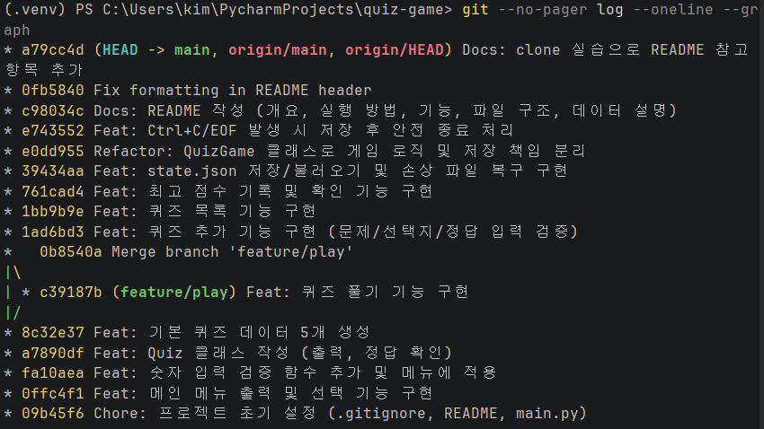
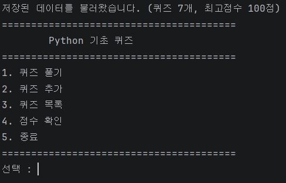
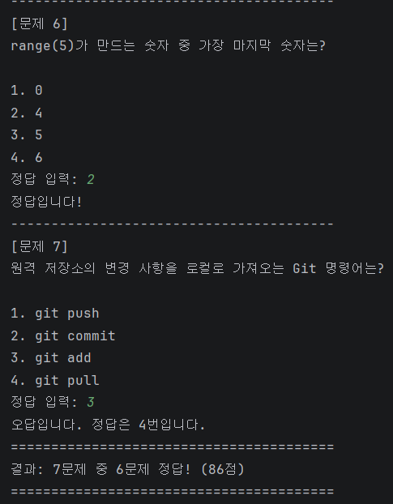
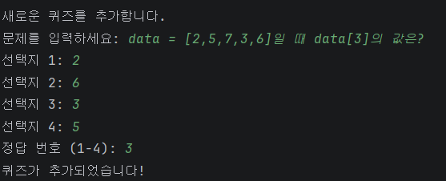
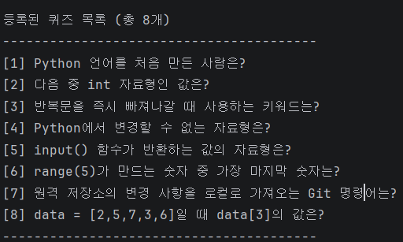
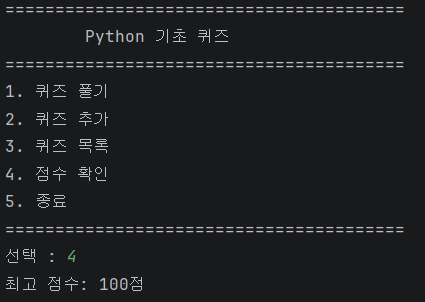
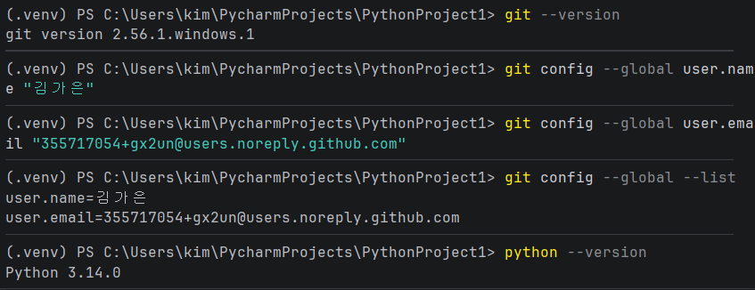

# Python 기초 퀴즈 게임

## 프로젝트 개요
터미널에서 실행되는 4지선다 퀴즈 게임입니다.
Python 기본 문법과 클래스(객체 지향)를 활용해 구현했으며,
퀴즈와 최고 점수를 `state.json` 파일에 저장해 프로그램을 종료해도 데이터가 유지됩니다.

## 퀴즈 주제 및 선정 이유
- **주제:** Python / 프로그래밍 기초
- **선정 이유:**  이번 과제에서 파이썬 기초에 대해서 배웠기 때문에 ️ 직접 퀴즈를 만들어 점검하고 복습하기 위해서 주제로 선정했습니다.

## 실행 방법
- Python 3.10 이상 필요 (외부 라이브러리 없음)

```bash
git clone https://github.com/gx2un/quiz-game.git
cd quiz-game
python main.py
```

## 기능 목록
| 메뉴 | 기능 |
|---|---|
| 1. 퀴즈 풀기 | 등록된 퀴즈를 순서대로 출제하고 정답/오답과 결과 점수를 보여줍니다. 최고 점수를 넘으면 갱신합니다. |
| 2. 퀴즈 추가 | 문제, 선택지 4개, 정답 번호를 입력받아 새 퀴즈를 등록하고 저장합니다. |
| 3. 퀴즈 목록 | 등록된 퀴즈의 문제 목록을 보여줍니다. |
| 4. 점수 확인 | 저장된 최고 점수를 보여줍니다. |
| 5. 종료 | 데이터를 저장하고 프로그램을 종료합니다. |

**입력 및 예외 처리**
- 숫자 입력 시 앞뒤 공백 제거, 빈 입력·문자·범위 밖 숫자는 안내 후 다시 입력
- `Ctrl+C`, `EOF` 발생 시 데이터를 저장하고 안전하게 종료
- `state.json`이 없으면 기본 퀴즈로 시작, 손상되었으면 안내 후 기본 퀴즈로 복구

## 파일 구조
```
quiz-game/
├── main.py        # 프로그램 전체 코드 (Quiz, QuizGame 클래스, 입력 함수)
├── state.json     # 실행 시 자동 생성되는 데이터 파일 (.gitignore로 제외)
├── README.md      # 프로젝트 설명
└── .gitignore     # Git에서 제외할 파일 목록
```

**클래스 구성**
- `Quiz`: 퀴즈 한 문제 (문제, 선택지, 정답 / 출력, 정답 확인, dict 변환)
- `QuizGame`: 게임 전체 (퀴즈 목록, 최고 점수 / 메뉴, 풀기, 추가, 목록, 점수, 저장·불러오기)

## 데이터 파일 설명 (state.json)
- **경로:** 프로젝트 루트 (`main.py`와 같은 폴더)
- **역할:** 퀴즈 목록과 최고 점수를 저장해 프로그램을 다시 실행해도 데이터를 유지합니다.
- **인코딩:** UTF-8
- **저장 시점:** 퀴즈 추가, 최고 점수 갱신, 프로그램 종료 시

**스키마**
| 키 | 타입 | 설명 |
|---|---|---|
| `quizzes` | list | 퀴즈 목록 |
| `quizzes[].question` | str | 문제 |
| `quizzes[].choices` | list[str] | 선택지 4개 |
| `quizzes[].answer` | int | 정답 번호 (1~4) |
| `best_score` | int 또는 null | 최고 점수 (100점 만점, 기록이 없으면 null) |

**예시**
```json
{
    "quizzes": [
        {
            "question": "Python 언어를 처음 만든 사람은?",
            "choices": ["리누스 토르발스", "제임스 고슬링", "귀도 반 로섬", "비야네 스트롭스트룹"],
            "answer": 3
        }
    ],
    "best_score": 80
}
```

## 설계 및 구조

### 클래스 역할 분리
```
┌───────────────────────────┐        ┌──────────────────────────┐
│ QuizGame                  │ 1    * │ Quiz                     │
│ (게임 전체 관리)            │───────▶│ (퀴즈 한 문제)              │
├───────────────────────────┤        ├──────────────────────────┤
│ quizzes: list[Quiz]       │        │ question: str            │
│ best_score: int | None    │        │ choices: list[str]       │
├───────────────────────────┤        │ answer: int (1~4)        │
│ run() / show_menu()       │        ├──────────────────────────┤
│ play_quiz() / add_quiz()  │        │ display(number)          │
│ list_quizzes()            │        │ is_correct(user_answer)  │
│ show_score()              │        │ to_dict() / from_dict()  │
│ update_best_score()       │        └──────────────────────────┘
│ save_state() / load_state()│
└───────────────────────────┘
        │ 사용
        ▼
  get_number() / get_text()   ← 입력 검증 함수 (클래스 밖)
```

| 구성 요소 | 책임 | 이렇게 나눈 이유 |
|---|---|---|
| `Quiz` | 문제 하나의 데이터와 출력, 채점, dict 변환 | 문제, 선택지, 정답은 항상 함께 다니는 데이터라 하나로 묶었습니다. 채점은 결과(True/False)만 반환하고 출력은 하지 않아, 점수 계산 방식이 바뀌어도 Quiz는 수정할 필요가 없습니다. |
| `QuizGame` | 퀴즈 목록과 최고 점수 보관, 메뉴 진행, 파일 저장 | 여러 기능이 같은 상태(퀴즈 목록, 최고 점수)를 공유하므로 속성(`self`)으로 관리했습니다. 함수로만 구현했을 때는 최고 점수(int)를 바꾸기 위해 매번 return으로 주고받아야 했는데, 클래스로 옮기면서 이 문제가 사라졌습니다. |
| `get_number()`, `get_text()` | 공백 제거, 빈 입력, 숫자 변환, 범위 검사 | 메뉴 선택, 정답 입력, 퀴즈 추가 등 여러 곳에서 같은 검증이 필요해 하나의 함수로 재사용했습니다. 게임 상태와 무관한 입력 도구라 클래스 밖에 두었습니다. |

### 프로그램 흐름
```
실행 → QuizGame() 생성 → load_state()
          │                  ├─ 파일 없음 → 기본 퀴즈 5개
          │                  └─ 파일 손상 → 안내 후 기본 퀴즈로 복구
          ▼
      run(): 메뉴 반복 ──▶ 1 풀기 → 최고 점수 갱신 시 저장
          │               2 추가 → 즉시 저장
          │               3 목록 / 4 점수
          │               5 종료 → 저장 후 종료
          └─ Ctrl+C / EOF → 안내 메시지 → 저장 후 종료
```

### 주요 설계 결정
- **데이터가 바뀌는 즉시 저장:** 종료할 때만 저장하면 비정상 종료 시 추가한 퀴즈가 사라지므로, 퀴즈 추가와 최고 점수 갱신 시점마다 저장합니다.
- **예외 처리 위치:** `KeyboardInterrupt`, `EOFError`는 `run()`에서 한 번에 처리합니다. 예외는 호출한 쪽으로 전파되므로, 퀴즈를 푸는 도중이든 추가하는 도중이든 같은 곳에서 안전하게 종료됩니다.
- **조기 반환(early return):** 퀴즈가 없거나 기록이 없는 경우를 함수 맨 앞에서 먼저 처리하고 `return`해 들여쓰기를 줄였습니다.
- **경로 고정:** `Path(__file__).parent`를 사용해 어느 위치에서 실행하더라도 `state.json`이 항상 프로젝트 루트에 저장됩니다.

## 데이터 저장 방식(JSON)의 선택 이유와 한계

### 선택 이유
- 표준 라이브러리(`json`)만으로 읽고 쓸 수 있어 외부 라이브러리가 필요 없습니다.
- Python의 dict, list와 구조가 거의 같아 변환이 간단합니다.
- 사람이 텍스트 편집기로 열어 내용을 직접 확인하고 수정할 수 있습니다.

### 한계
| 한계 | 설명 | 개선 방향 |
|---|---|---|
| 객체를 직접 저장할 수 없음 | `Quiz` 객체는 JSON으로 바로 저장되지 않아 `to_dict()` / `from_dict()` 변환이 필요합니다. | 데이터 클래스(`dataclasses.asdict`) 활용 |
| 저장할 때마다 파일 전체를 다시 씀 | 퀴즈 하나만 추가해도 전체 데이터를 다시 기록합니다. 데이터가 많아지면 느려집니다. | 데이터가 커지면 SQLite 등 데이터베이스 사용 |
| 쓰는 도중 중단되면 파일이 깨질 수 있음 | 저장 중 프로그램이 강제 종료되면 파일이 일부만 기록될 수 있습니다. 현재는 손상 시 기본 데이터로 복구하지만, 그동안의 기록은 사라집니다. | 임시 파일에 먼저 쓰고 교체(`os.replace`)하거나 백업 파일 유지 |
| 값의 형식은 검증하지 않음 | 키가 없거나 구조가 틀린 경우는 처리하지만, 정답이 1~4 범위인지, 선택지가 4개인지는 불러올 때 확인하지 않습니다. | 불러올 때 각 퀴즈의 값 검증 추가 |
| 동시 사용 불가 | 프로그램 두 개가 동시에 실행되면 나중에 저장한 쪽이 앞의 내용을 덮어씁니다. | 파일 잠금 또는 데이터베이스 사용 |
| 검색, 정렬 기능 없음 | 특정 퀴즈를 찾으려면 전체를 불러와 반복해야 합니다. | 데이터베이스의 쿼리 기능 활용 |

## Git 작업 내역

### 커밋 메시지 규칙
`타입: 변경 내용 요약` 형식으로 작성했습니다. 기능 하나가 완성될 때마다 커밋했습니다.

| 타입 | 의미 | 예시 |
|---|---|---|
| `Feat` | 새 기능 추가 | `Feat: 퀴즈 추가 기능 구현` |
| `Refactor` | 동작은 그대로 두고 구조 개선 | `Refactor: QuizGame 클래스로 게임 로직 및 저장 책임 분리` |
| `Docs` | 문서 수정 | `Docs: README 작성` |
| `Chore` | 설정 등 기타 작업 | `Chore: 프로젝트 초기 설정` |
| `Fix` | 버그 수정 | `Fix: 점수 계산 오류 수정` |

### 브랜치 전략
- `main`: 항상 실행 가능한 상태를 유지하는 기본 브랜치입니다.
- `feature/기능명`: 새 기능은 별도 브랜치에서 작업한 뒤 `main`에 병합합니다.
- 퀴즈 풀기 기능을 `feature/play` 브랜치에서 개발하고 `git merge --no-ff`로 병합했습니다. `--no-ff` 옵션으로 병합 커밋을 남겨, 브랜치에서 작업했다는 기록이 그래프에 보이도록 했습니다.

```bash
git checkout -b feature/play          # 브랜치 생성 및 이동
git commit -m "Feat: 퀴즈 풀기 기능 구현"
git checkout main                     # main으로 이동
git merge --no-ff feature/play        # 병합
```

### 커밋 히스토리
| 순서 | 커밋 | 내용 |
|---|---|---|
| 1 | `Chore: 프로젝트 초기 설정` | .gitignore, README, main.py 생성 |
| 2 | `Feat: 메인 메뉴 출력 및 선택 기능 구현` | 메뉴 반복과 종료 |
| 3 | `Feat: 숫자 입력 검증 함수 추가` | 공백, 빈 입력, 문자, 범위 처리 |
| 4 | `Feat: Quiz 클래스 작성` | 출력, 정답 확인 |
| 5 | `Feat: 기본 퀴즈 데이터 5개 작성` | Python 기초 문제 |
| 6 | `Feat: 퀴즈 풀기 기능 구현` | **feature/play 브랜치** |
| 7 | `Merge branch 'feature/play'` | main에 병합 |
| 8 | `Feat: 퀴즈 추가 기능 구현` | 문제, 선택지, 정답 입력 검증 |
| 9 | `Feat: 퀴즈 목록 기능 구현` | |
| 10 | `Feat: 최고 점수 기록 및 확인 기능 구현` | |
| 11 | `Feat: state.json 저장/불러오기 구현` | 손상 파일 복구 |
| 12 | `Refactor: QuizGame 클래스로 분리` | 함수 → 클래스 구조 |
| 13 | `Feat: Ctrl+C/EOF 안전 종료 처리` | |
| 14 | `Docs: README 작성` | |
| 15 | `Docs: clone 실습으로 README 수정` | **clone한 저장소에서 작업** |

### clone / pull 실습
1. `git clone https://github.com/gx2un/quiz-game.git quiz-game-clone`으로 별도 폴더에 복제했습니다.
2. 복제한 폴더에서 README에 한 줄을 추가하고 commit, push했습니다.
3. 기존 작업 폴더에서 `git pull`로 변경 사항을 가져왔습니다. (Fast-forward로 충돌 없이 반영)
4. `git log`와 README 내용으로 반영된 것을 확인했습니다.

### 사용한 Git 명령어
| 명령어 | 역할 | 사용한 시점 |
|---|---|---|
| `init` | 현재 폴더를 Git 저장소로 만듦 | 프로젝트 시작 |
| `add` | 변경 파일을 커밋 대기 영역(stage)에 올림 | 매 커밋 전 |
| `commit` | stage의 변경 사항을 기록으로 저장 | 기능 완성마다 |
| `push` | 로컬 커밋을 GitHub에 업로드 | 커밋 후 |
| `checkout` | 브랜치 생성 및 이동 | feature/play 작업 |
| `merge` | 브랜치를 합침 | feature/play → main |
| `clone` | 원격 저장소를 통째로 복제 | clone 실습 |
| `pull` | 원격 변경 사항을 가져와 합침 | clone 실습 |



## 참고
- 이 줄은 clone한 저장소에서 추가한 내용입니다. (clone/pull 실습)


## 실행 화면
### 메뉴


### 퀴즈 풀기


### 퀴즈 추가


### 퀴즈 목록


### 점수 확인


### 개발 환경


### Git 커밋 기록

